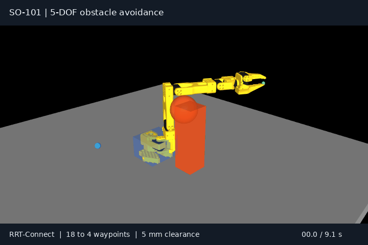
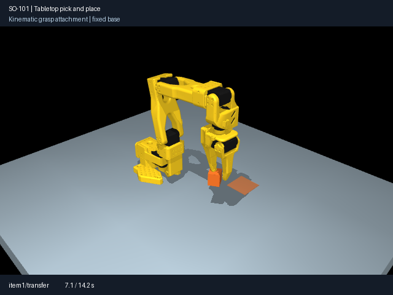
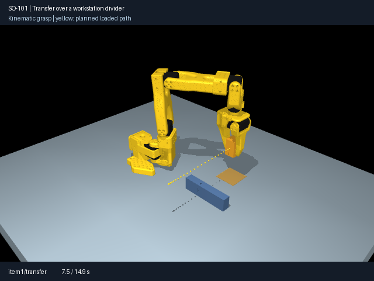
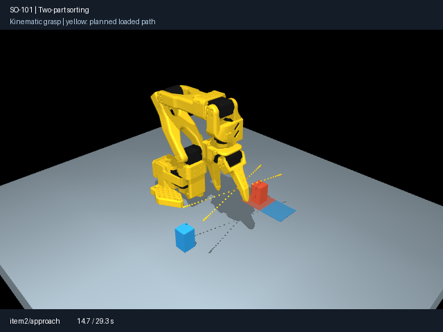
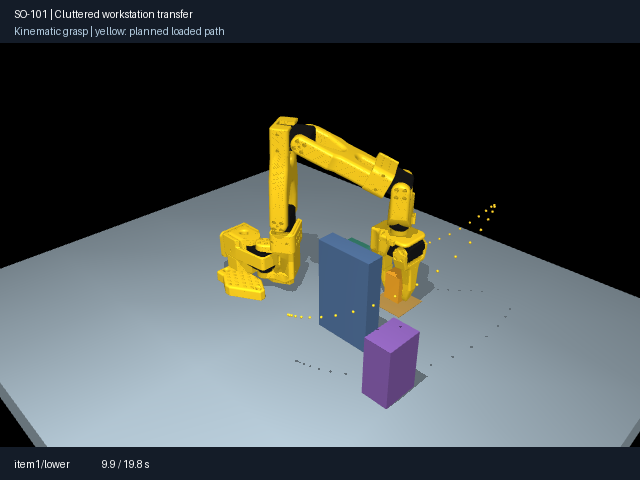
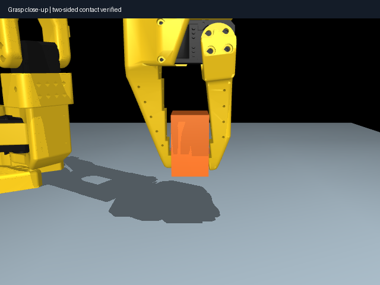
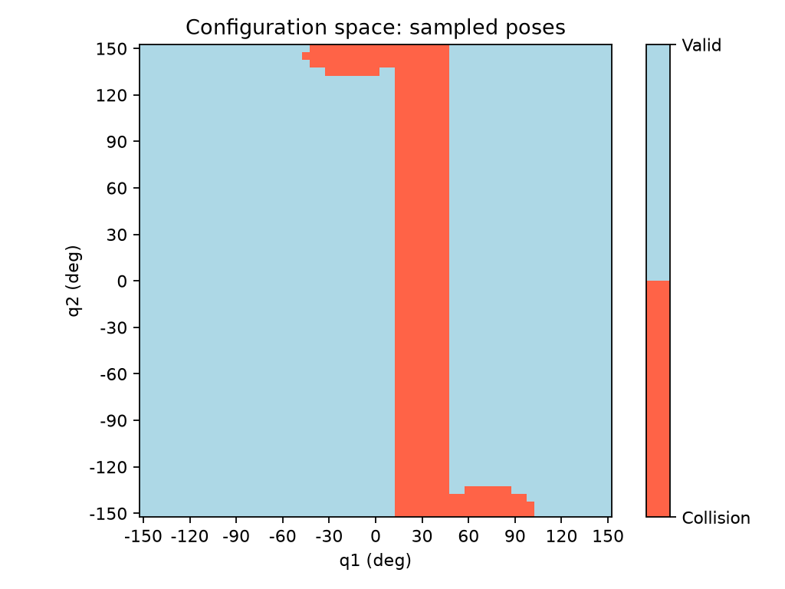

# SO-101 五自由度空间避障

给定障碍物的位置、尺寸和机械臂起终关节角，自动完成。

项目从平面二连杆扩展到 SO-101 五自由度机械臂，将运动学、关节空间搜索、全臂碰撞检测和轨迹生成组合为可配置、可复现的一键 Demo。

## Demo



机械臂从起始姿态出发，在桌面环境中绕过球体和盒体，到达目标姿态。黄色轨迹显示工具参考点的运动，绿色和蓝色标记分别表示起点与终点。

| 演示参数 | 数值 |
| --- | --- |
| 规划变量 | 五个旋转关节 |
| 障碍环境 | 桌面、底座、球体、盒体 |
| 规划算法 | RRT-Connect |
| 路径简化 | 18 个路点 → 4 个路点 |
| 关节空间路径长度 | 4.300 → 3.461 rad |
| 安全裕量 | 5 mm |
| 时间轨迹 | 9.081 s，654 个采样点 |
| 随机种子 | 42 |

## 固定机械臂操作场景

新增五种固定 SO-101 桌面任务：**方块搬运、跨隔挡转移、双物料分拣、高隔挡绕行、多障碍工作台**。每个物料执行接近、下降、闭合、抬升、转移、降低、张开和撤离动作。

| 桌面搬运 | 隔挡转移 | 双物料分拣 |
| --- | --- | --- |
|  |  |  |

```bash
python -m pip install -e ".[sim,dev,media,plot]"
python examples/so101/manipulation.py --case tabletop
python examples/so101/manipulation.py --case barrier
python examples/so101/manipulation.py --case sorting
python examples/so101/manipulation.py --case detour
python examples/so101/manipulation.py --case clutter
# 无窗口计算、复核并导出动画和轨迹图
MUJOCO_GL=egl python examples/so101/manipulation.py --case barrier --check-only --export
```

高隔挡与多障碍场景会阻断直线转移，调用 RRT-Connect 搜索携物路径和空手返回路径。黄色点线显示携物转移轨迹；绑定物料前校验两侧夹指接触和夹持位置。

| 多障碍绕行 | 双侧夹持特写 |
| --- | --- |
|  |  |

操作演示采用运动学轨迹与显式物体绑定，记录关节、夹爪和物料的同步动作，执行全臂及搬运物体的几何复核。配置、算法和结果见 [固定机械臂操作说明](docs/so101/manipulation.md)。

## 功能

- **五关节正运动学**：按模型的固定安装变换与关节旋转连乘，计算工具坐标系位姿。
- **三维碰撞检测**：检查机械臂、夹爪与环境的接触、自碰撞、关节限位及障碍间隙。
- **连接有效性检查**：沿关节空间插值，按最大逐关节角度变化确定检查密度。
- **RRT-Connect 规划**：双树交替扩展，按各关节限位采样，通过父节点回溯生成路径。
- **碰撞约束路径简化**：优先尝试连接远端路点，保留有效捷径。
- **五次时间缩放**：按每个关节的速度、加速度限制计算时长，在各路点以零速度和零加速度衔接。
- **统一场景配置**：集中设置起终点、障碍位置与尺寸、裕量、随机种子和轨迹参数。
- **演示与结果保存**：按轨迹时间戳播放参考姿态，导出路径、轨迹、参数和运行指标。

## 快速开始

环境：Python 3.11+，支持 OpenGL 的图形环境。

```bash
git clone https://github.com/linx29853/5DOF-obstacle-avoidance.git
cd 5DOF-obstacle-avoidance
python3 -m venv .venv
source .venv/bin/activate
python -m pip install -e ".[sim,dev,media]"
python examples/so101/demo.py
```

程序自动规划并弹出 MuJoCo 窗口，播放结束后停留在目标姿态。关闭窗口退出。

### 三种演示场景

```bash
# 球体与盒体组成的多障碍场景
python examples/so101/demo.py --case multi

# 单球障碍
python examples/so101/demo.py --case single

# 起点被障碍覆盖，输出失败原因
python examples/so101/demo.py --case blocked

# 完成全部计算与复核，保存结果
python examples/so101/demo.py --check-only
```

### 修改障碍物和目标

编辑 [`configs/so101/demo.json`](configs/so101/demo.json)：

| 配置项 | 含义 | 单位 |
| --- | --- | --- |
| `start_degrees`、`goal_degrees` | 五关节起终角度 | ° |
| `cases.*.obstacles[].center` | 障碍物中心，相对于世界坐标系 | m |
| `radius` | 球体半径 | m |
| `half_size` | 盒体三个方向的半尺寸 | m |
| `margin_mm` | 碰撞安全裕量 | mm |
| `planning` | 随机种子、扩展步长、搜索预算 | — |
| `trajectory` | 逐关节速度、加速度及采样周期 | rad/s、rad/s²、s |

五个关节的顺序为：底座旋转、肩俯仰、肘屈伸、腕俯仰、腕旋转。夹爪使用固定开度，几何体参与碰撞检查。

```bash
python examples/so101/demo.py --config configs/so101/demo.json --case multi
```

## 运行流程

```text
场景配置 + 起终关节角
          ↓
关节限位、碰撞与安全裕量检查
          ↓
五维 RRT-Connect → 路径简化
          ↓
逐关节速度 / 加速度约束下的五次时间轨迹
          ↓
轨迹与连接复核 → MuJoCo 播放 → 保存结果
```

规划连接采用 1° 最大逐关节采样间隔，路径和轨迹连接以 0.5° 间隔复核。整个流程统一使用配置中的安全裕量。

## 输出与 GIF 导出

每次运行会在 `outputs/so101/demo/` 创建独立目录：

```text
multi-xxxxxxxx/
├── request.json          完整参数
├── scene.json            本次场景
├── path.npy              原始路径
├── path_simplified.npy   简化路径
├── trajectory.npz        时间、位置、速度、加速度
└── result.json           运行指标、版本和源码校验值
```

将终端输出的结果目录传给导出入口，即可生成 GIF 和 PNG 封面：

```bash
MUJOCO_GL=egl python examples/so101/export_demo.py outputs/so101/demo/multi-xxxxxxxx
```

默认输出：`assets/demo/so101-obstacle-avoidance.gif` 与同名 PNG。导出动画使用保存的时间轨迹和场景配置重新渲染。

## 评测与测试

```bash
# 空场、单障碍、多障碍：各运行种子 0～4，并检查失败分支
python examples/so101/evaluate_planning_exp.py

# SO-101 场景与 Demo 自动测试
PYTEST_DISABLE_PLUGIN_AUTOLOAD=1 python -m pytest tests/so101 -q
```

空场、单障碍与多障碍共 15 次规划均找到路径，并通过连接复核。评测文件记录成功情况、耗时、路径长度、碰撞检查次数、依赖版本和源码校验值。

## 项目结构

```text
src/
├── so101/                 五自由度模型、运动学、碰撞、规划、轨迹与 Demo
└── *.py                   平面二连杆运动学、规划、动力学与控制
examples/so101/            一键演示、逐模块实验、评测与 GIF 导出
tests/so101/               场景与 Demo 回归测试
configs/so101/             场景、关节与演示参数
models/so101/official/     官方 MJCF、URDF、网格与许可证
assets/demo/              Demo GIF 与封面
docs/so101/                使用说明与任务清单
```

## 二连杆基础实验

仓库同时包含平面二连杆实验：DH 正运动学、解析与数值逆运动学、雅可比、圆形障碍碰撞检测、构型空间可视化、A*、RRT-Connect、路径简化、五次轨迹、PD 与计算力矩跟踪。



## 模型来源与文档

SO-101 模型来自 [TheRobotStudio/SO-ARM100](https://github.com/TheRobotStudio/SO-ARM100)，使用 `so101_new_calib.xml`。版本记录见 [`manifest.json`](models/so101/manifest.json)，模型许可证保存在 [`official/LICENSE`](models/so101/official/LICENSE)。桌面、障碍物和底座碰撞盒由场景配置添加。

- [Demo 使用说明](docs/so101/demo.md)
- [任务清单](docs/so101/implementation-checklist.md)
- [二连杆 RRT-Connect 实验](docs/experiment-06-rrt-connect.md)
- [路径简化实验](docs/experiment-07-path-simplification.md)
