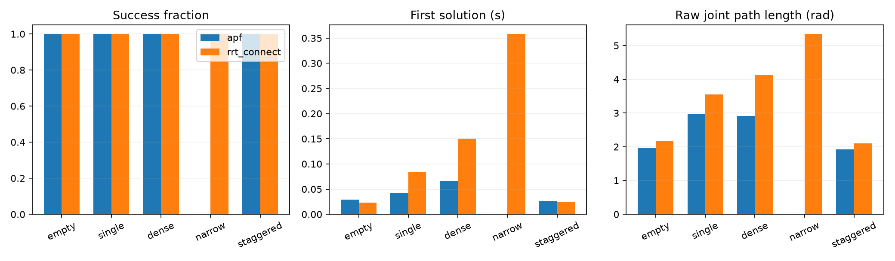

# SO-101：APF 与 RRT-Connect 首轮对比

两种方法使用相同的五关节模型、固定起终构型、关节限位和环境；规划连接与最终独立复核均采用 0.5° 插值间隔、5 mm 环境裕量。每次规划时间上限为 10 秒，找到首解后停止。规划、统一路径简化与复核分别计时。

每类场景选取第一个 formal 实例。APF 为确定性算法，每例运行一次；RRT-Connect 每例使用 0、1、2 三个种子，共 20 次运行。表中 RRT 时间与长度为成功运行的中位数。

| 场景 | APF 成功 | RRT-Connect 成功 | 首解时间 APF / RRT 中位数（秒） | 原始长度 APF / RRT 中位数（rad） |
|---|---:|---:|---:|---:|
| 空场 | 1/1 | 3/3 | 0.0290 / 0.0233 | 1.9665 / 2.1813 |
| 单障碍 | 1/1 | 3/3 | 0.0429 / 0.0846 | 2.9727 / 3.5511 |
| 密集障碍 | 1/1 | 3/3 | 0.0660 / 0.1498 | 2.9127 / 4.1189 |
| 狭窄通道 | 0/1 | 3/3 | — / 0.3582 | — / 5.3423 |
| 交错挡板 | 1/1 | 3/3 | 0.0263 / 0.0237 | 1.9197 / 2.0989 |



## 方法与参数

APF 使用关节弧度空间的二次目标吸引势能，以及所有运动连杆碰撞几何体到桌面和环境障碍的表面距离斥势能。斥力影响范围 0.08 m，增益 0.00002，安全距离扣除 0.005 m。梯度使用 0.001 rad 有限差分，最大步长 15°，回溯最多 14 次。斥力面向环境，自碰撞与限位由共享有效性检查拒绝。APF 不使用随机重启、引导点或 RRT 兜底；无法找到下降且无碰撞的步进时记录 local_minimum_or_blocked。

RRT-Connect 使用双树连接、均匀采样、弧度欧氏距离及 15° 步长。两者都接收起终构型，参考路径只用于验证实例可解。

APF 势能评估额外执行前向运动学，计入 pose_checks，并单列 potential_evaluations 与 potential_seconds。由于距离查询与布尔碰撞查询成本不同，本轮以相同墙钟上限比较。原始 JSONL 保留成功路径、失败原因、完整统计和简化后长度。

## 结果分析

APF 在 5 个任务中成功 4 个，RRT-Connect 在 15 次运行中成功 15 次。单障碍与密集障碍实例中，APF 的首解时间和原始路径长度均低于 RRT-Connect 的中位数。狭窄通道实例的 APF 回溯下降受阻，而 RRT-Connect 的三个种子均找到有效路径，体现局部下降方法与全局采样搜索的差异。

空场与本轮交错挡板实例的简化路径接近直连，不能提供多次绕行的区分信息。下一轮增加实际穿越挡板的起终构型，并扩展每类场景的任务数；统计结论以任务数量与种子数量分别报告。本轮参数固定运行，记录用于首轮方法对比。

## 复现

```bash
OPENBLAS_NUM_THREADS=1 OMP_NUM_THREADS=1 MKL_NUM_THREADS=1 python examples/so101/compare_apf.py --output outputs/so101/apf-comparison
```

单进程执行；系统可用内存低于 3 GiB 或进程 RSS 超过 1.5 GiB 时中止。每条原始记录完成后写盘。metadata.json 保存代码哈希、源码提交、依赖版本和硬件信息。
