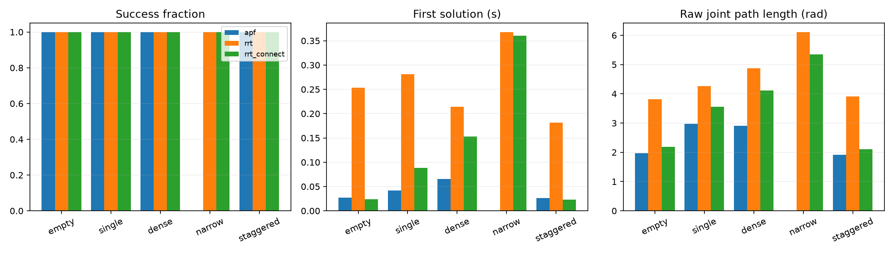

# SO-101：APF、单树 RRT、RRT-Connect 对比

## 实验设置

每类场景选取第一个 formal 实例，共 5 个任务。APF 为确定性算法，每任务运行一次；单树 RRT 与 RRT-Connect 每任务使用 0、1、2 三个种子。共 35 次运行。

所有算法共享五关节模型、起终构型、关节限位、弧度欧氏距离、15° 最大扩展步长及碰撞有效性接口。每次规划上限 10 秒，找到首解后停止。规划连接及独立路径复核使用 0.5° 插值与 5 mm 裕量。路径简化采用同一过程；规划、后处理和复核分别计时。参考路径只用于实例可解性验证。

单树 RRT 从起点生长，默认目标偏置 5%；RRT-Connect 双树交替扩展，采用均匀采样。此设置比较两种算法的默认策略，目标偏置差异单独记录在 options 中。

APF 使用关节空间二次吸引势能和运动连杆到桌面、环境障碍的表面距离斥势能。斥力影响范围 0.08 m、增益 0.00002，距离扣除 5 mm 裕量；梯度差分间隔 0.001 rad，回溯最多 14 次。自碰撞通过共享有效性检查拒绝。无随机重启、引导点或采样算法兜底。

APF 势能评估计入构型资源统计，单列 potential_evaluations 和 potential_seconds。不同查询成本以墙钟时间反映。

## 实测结果

APF：4/5 成功；单树 RRT：15/15 成功；RRT-Connect：15/15 成功。

表中时间和长度统计只包含成功运行，失败样本保留在成功次数分母中。APF 每项 n=1，采样算法每项最多 n=3。

| 场景 | 算法 | 成功次数 / 运行次数 | 首解时间中位数（秒） | 原始长度中位数（rad） | 简化长度中位数（rad） |
|---|---|---:|---:|---:|---:|
| 空场 | APF | 1/1 | 0.0269 | 1.9665 | 1.9665 |
| 空场 | 单树 RRT | 3/3 | 0.2530 | 3.8175 | 1.9665 |
| 空场 | RRT-Connect | 3/3 | 0.0239 | 2.1813 | 1.9665 |
| 单障碍 | APF | 1/1 | 0.0415 | 2.9727 | 2.3569 |
| 单障碍 | 单树 RRT | 3/3 | 0.2811 | 4.2613 | 2.5537 |
| 单障碍 | RRT-Connect | 3/3 | 0.0887 | 3.5511 | 2.5547 |
| 密集障碍 | APF | 1/1 | 0.0656 | 2.9127 | 2.5653 |
| 密集障碍 | 单树 RRT | 3/3 | 0.2141 | 4.8761 | 2.9688 |
| 密集障碍 | RRT-Connect | 3/3 | 0.1528 | 4.1189 | 3.1033 |
| 狭窄通道 | APF | 0/1 | — | — | — |
| 狭窄通道 | 单树 RRT | 3/3 | 0.3680 | 6.1128 | 4.1133 |
| 狭窄通道 | RRT-Connect | 3/3 | 0.3605 | 5.3423 | 4.0510 |
| 交错挡板 | APF | 1/1 | 0.0265 | 1.9197 | 1.9197 |
| 交错挡板 | 单树 RRT | 3/3 | 0.1817 | 3.9106 | 1.9197 |
| 交错挡板 | RRT-Connect | 3/3 | 0.0230 | 2.0989 | 1.9197 |



## 分析与扩展

原始路径反映首解质量，简化后长度反映相同后处理下的质量。两者分别比较；采样算法的首解路径会随种子改变。

APF 的 local_minimum_or_blocked 表示回溯无法找到同时降低势能且通过碰撞检查的下一步。空场及本轮交错挡板任务接近直连；后续增加必须穿越挡板的起终构型，并扩展每类任务数量。成功率按任务和种子分别记录。

## 复现与原始数据

```bash
OPENBLAS_NUM_THREADS=1 OMP_NUM_THREADS=1 MKL_NUM_THREADS=1 python examples/so101/compare_apf.py --output outputs/so101/apf-rrt-comparison
```

单进程执行，可用内存低于 3 GiB 或进程 RSS 超过 1.5 GiB 时停止。每条记录完成后写盘。

- records.jsonl：路径、种子、预算、失败原因、耗时与计数。
- summary.csv：逐次运行结果。
- metadata.json：依赖、硬件、源码提交与文件哈希。
